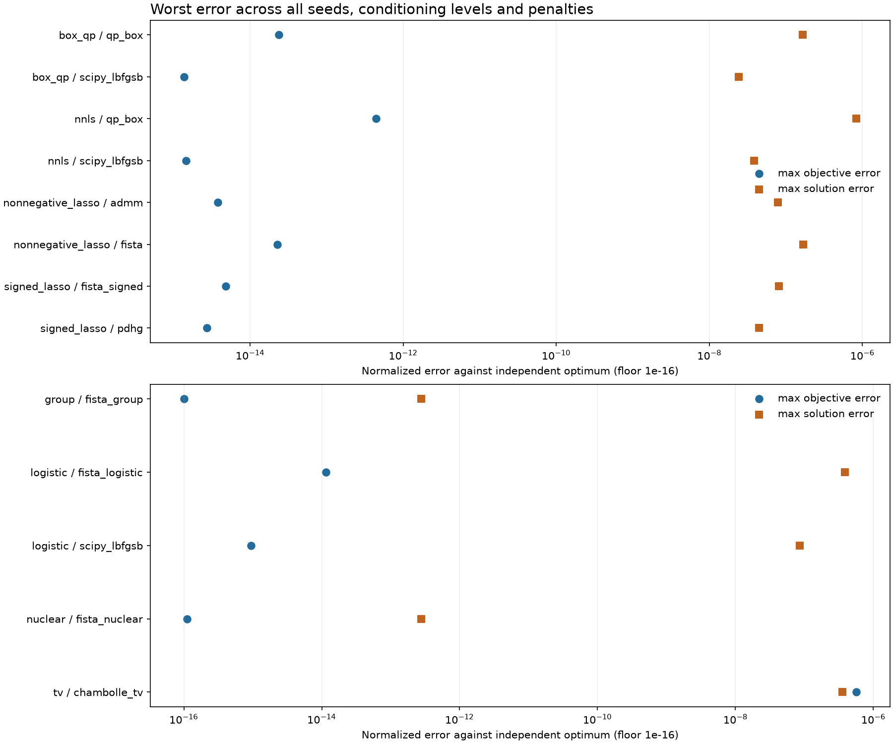
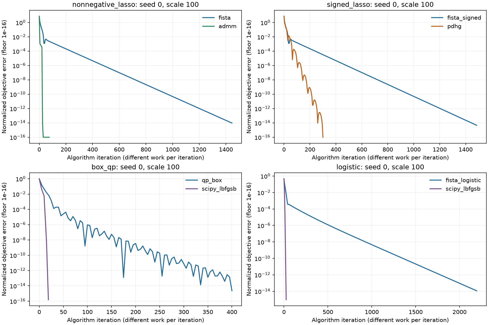
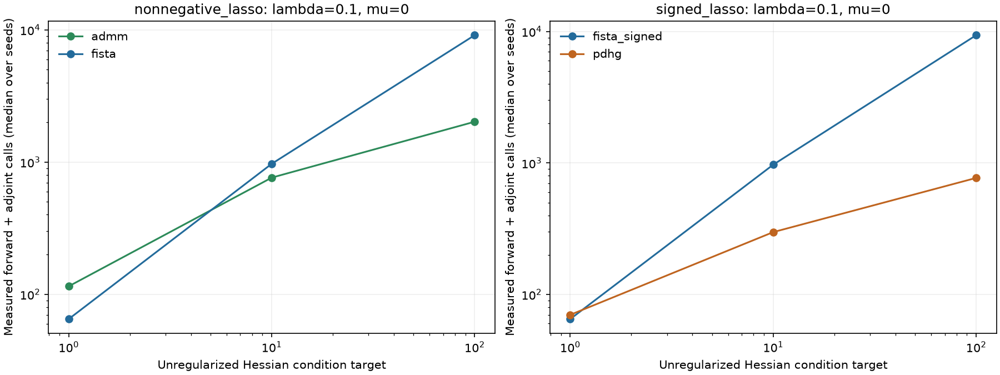

# Standard optimization results

**177/177 comparisons passed**; 0 failed.

References are independent analytic optima or manufactured KKT solutions, not another tested solver and not the generating signal.

[Per-run measured metrics and configurations](metrics.json)

- Seeds: `[0, 1, 2]`; conditioning targets: `[1.0, 10.0, 100.0]`.
- Default fixture sizes: 8-variable vector problems, 4x4 nuclear denoising, and 2-point TV. This is a small correctness suite, not a large-scale performance benchmark.
- Certificate and normalized objective tolerances: `1e-06`.
- Normalized solution tolerance: `0.001`; identity group/nuclear cases `1e-9`; two-point TV `1e-5`.
- Objective error denominator: `max(1, abs(f_star))`; solution error denominator: `max(1, norm(x_star))`.
- Wall time includes solver certificate work and SciPy callback certificates, excludes fixture/reference construction and report generation. Tiny single-run timings are descriptive, not a statistically controlled speed ranking.
- Operator counts are actual forward / adjoint invocations, including initialization, norm estimates, backtracking, CG and certificates. `n/a` means a dense-only API without operator counters, not zero work.
- TV's stationarity field is an absolute primal-dual gap; nuclear uses a normalized Frobenius proximal fixed-point residual. Neither is a literal KKT norm. Logistic conditioning is a design scaling target, not its optimum Hessian condition.
- Group/nuclear/TV rows have an exact reference but only one implemented algorithm; they do not establish comparative speed superiority.

## Accuracy and measured cost

| problem | algorithm | runs | max objective error | max solution error | median iters | median forward / adjoint | median ms |
|---|---|---:|---:|---:|---:|---:|---:|
| box_qp | qp_box | 9 | 2.362e-14 | 1.654e-07 | 55 | n/a | 2.491 |
| box_qp | scipy_lbfgsb | 9 | 1.357e-15 | 2.418e-08 | 10 | n/a | 2.300 |
| group | fista_group | 6 | 5.551e-17 | 2.778e-13 | 10 | 24 / 24 | 1.240 |
| logistic | fista_logistic | 18 | 1.144e-14 | 3.871e-07 | 10 | n/a | 2.284 |
| logistic | scipy_lbfgsb | 18 | 9.437e-16 | 8.574e-08 | 3.5 | n/a | 0.876 |
| nnls | qp_box | 9 | 4.410e-13 | 8.332e-07 | 90 | n/a | 3.614 |
| nnls | scipy_lbfgsb | 9 | 1.443e-15 | 3.866e-08 | 12 | n/a | 2.046 |
| nonnegative_lasso | admm | 18 | 3.775e-15 | 7.836e-08 | 60.5 | 385.5 / 386.5 | 10.328 |
| nonnegative_lasso | fista | 18 | 2.273e-14 | 1.680e-07 | 135 | 582 / 325 | 9.424 |
| nuclear | fista_nuclear | 3 | 1.110e-16 | 2.784e-13 | 10 | 120 / 123 | 1.446 |
| signed_lasso | fista_signed | 27 | 4.774e-15 | 8.079e-08 | 125 | 540 / 303 | 8.806 |
| signed_lasso | pdhg | 27 | 2.692e-15 | 4.454e-08 | 75 | 131 / 131 | 2.998 |
| tv | chambolle_tv | 6 | 5.663e-07 | 3.540e-07 | 35 | n/a | 0.714 |

## Generating-signal recovery (separate from optimization error)

| problem | algorithm | median recovery error |
|---|---|---:|
| nonnegative_lasso | admm | 1.672e-01 |
| nonnegative_lasso | fista | 1.672e-01 |
| signed_lasso | fista_signed | 1.724e-01 |
| signed_lasso | pdhg | 1.724e-01 |

## Figures







## Environment and reproducibility

- python: `3.12.10`
- system: `Windows`
- machine: `AMD64`
- numpy: `2.4.4`
- scipy: `1.17.1`
- matplotlib: `3.11.2`

From the repository root:

```powershell
python -m pip install -e ".[test,benchmark]"
python -W error -m benchmarks.bench_standard --out-dir benchmarks/out/standard
```

The generated `standard_results.json` contains every result, input digest, history checkpoint and explicit optimizer configuration. Its call counts and timings should not be compared to legacy iteration-based cost estimates. The checked-in plots and summary are a snapshot of one machine run.
